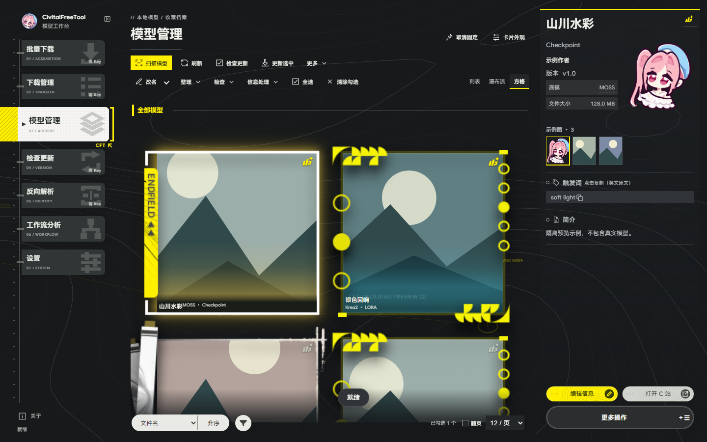
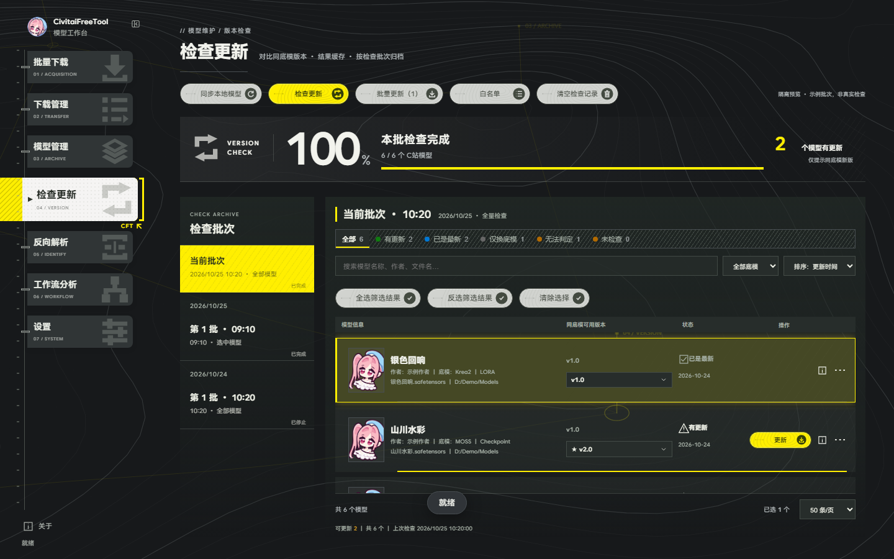
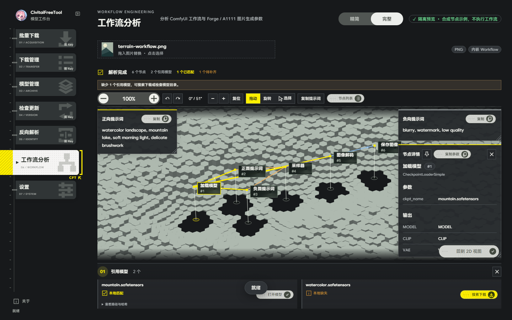

# CivitaiFreeTool

**把模型下载、整理和生成信息，放在一个工作台。**

免费的 Civitai / Hugging Face 模型下载与本地模型管理工具。当前 Windows 稳定版 **3.0.9**，浏览器扩展 **1.3.1**。

[下载 Windows 版](https://github.com/ADVICEsama/CivitaiFreeTool/releases/tag/v3.0.9) · [项目首页](https://advicesama.github.io/CivitaiFreeTool/) · [所有版本](https://github.com/ADVICEsama/CivitaiFreeTool/releases) · [反馈问题](https://github.com/ADVICEsama/CivitaiFreeTool/issues)



> 截图使用隔离的示例数据，展示当前界面布局，不包含用户模型、账号或下载任务。

## 下载与更新

| 需要什么 | 下载入口 |
| --- | --- |
| Windows 10 / 11 主程序 | [便携 ZIP](https://github.com/ADVICEsama/CivitaiFreeTool/releases/download/v3.0.9/CivitaiFreeTool-Windows-v3.0.9.zip) · [独立 EXE](https://github.com/ADVICEsama/CivitaiFreeTool/releases/download/v3.0.9/CivitaiFreeToolWeb-3.0.9.exe) |
| Chrome / Edge 插件 | [Chrome ZIP](https://github.com/ADVICEsama/CivitaiFreeTool/releases/download/v3.0.9/CivitaiFreeTool-ChromeExtension-v3.0.9.zip) |
| Firefox 插件 | [Firefox ZIP](https://github.com/ADVICEsama/CivitaiFreeTool/releases/download/v3.0.9/CivitaiFreeTool-FirefoxExtension-v3.0.9.zip)（未签名，临时加载） |
| 对应源码与校验 | [源码 ZIP](https://github.com/ADVICEsama/CivitaiFreeTool/releases/download/v3.0.9/CivitaiFreeTool-Source-v3.0.9.zip) · [SHA256SUMS](https://github.com/ADVICEsama/CivitaiFreeTool/releases/download/v3.0.9/SHA256SUMS.txt) |

- ZIP 解压后运行 `CivitaiFreeToolWeb.exe`，不是安装向导；Windows 窗口使用 WebView2。
- **更新前正常退出旧版**，再替换 EXE。保留原有配置、任务、历史和缓存，不需要重新下载模型。
- 请从本仓库 Releases 获取文件。上表对应 3.0.9；后续版本见「所有版本」。
- Linux / macOS 使用源码与 Qt 后端，见 [平台说明](LINUX.md)；本文的 EXE、原生窗框与桌面悬浮窗说明针对 Windows。

## 三步开始

1. **选择模型目录**：设置 → 目录与账号，加入现有模型文件夹并扫描。扫描不会移动模型。
2. **按需填写账号**：在设置保存 Civitai API Key。新手引导可跳过，之后再配置；联网查询和下载仍需满足来源的访问要求。
3. **发送模型链接**：在批量下载页粘贴链接，或使用浏览器插件。先检查保存位置，再到下载管理查看状态。

## 七个页面，各司其职

| 页面 | 可以做什么 |
| --- | --- |
| **批量下载** | 输入模型链接、选择下载文件与保存位置，发送到队列。 |
| **下载管理** | 开始 / 继续、暂停、重试、移除；按实际字节显示进度，完成动画后自动转入按日期与批次分组的历史。 |
| **模型管理** | 瀑布流、方格、列表三种视图；收藏、筛选、封面和示例图、触发词、简介，以及批量整理操作。 |
| **检查更新** | 对比同底模可用版本，按检查批次保留结果；单击选择，信息按钮查看详情，全选和反选只作用于当前筛选结果，支持跨页。 |
| **反向解析** | 对本地文件匹配来源模型信息，查看匹配、失败和待处理状态。不能保证来源已删除或无记录的模型一定可匹配。 |
| **工作流分析** | 读取图片或工作流文件中的生成信息，查看真实 ComfyUI 节点连接、正负提示词、引用模型和本地缺失情况。支持 3D 沙盘与 2D 图。 |
| **设置** | 管理目录、账号、字体回退、快捷键、网络代理、翻译、性能及启动行为。 |



### 工作流分析：看懂图片背后的生成过程

- 按文件实际包含的信息解析。支持的 ComfyUI 工作流会保留节点连接；没有节点图的数据使用参数展示，不凭空补出原始工作流。
- 3D 模式左键默认拖动，空格 + 左键旋转；顶部可切换左键功能，右下角可切回 2D。
- 2D 可以拖动节点重新排布，连接随之更新；位置仅保留在本次会话，**不写回原图片**。
- 提示词可单独复制，节点详情支持调整尺寸与固定；底部列出引用模型及可判断的本地缺失信息。
- 这是分析与查看功能，**不执行工作流，不生成图片**；元数据被剥离、外部动态节点或无法还原的内容会存在解析限制。



## 外观与性能

界面采用终末地亮 / 暗两套主题：黄色强调、等高线背景、一体化导航和统一胶囊操作按钮。字体与回退顺序、卡片信息遮罩、底模 / 文件夹外观分配可以单独设置；不会修改系统字体。

设置 → **性能**集中管理界面动画、背景帧率、拖动暂缓、帧数显示、GPU 兼容性和缓存。

| 档位 | 行为 |
| --- | --- |
| **极致** | 完整动画，高精度背景，背景不锁 60 FPS，跟随屏幕刷新调度。 |
| **高** | 完整动画，背景上限 60 FPS；拖动窗口时暂缓动效，松手恢复。 |
| **均衡** | 保留动画，背景上限 30 FPS，降低背景绘制负担。 |
| **低** | 关闭界面动画，保留静态外观，不停止下载或视频。 |

实际帧率取决于屏幕、设备与 WebView，不保证达到设定上限。首次升级可选择档位或保留现有设置。GPU 默认不禁用；“禁用 GPU 加速”是兼容性排障选项，不是性能加速开关。

## 浏览器插件

插件可发送当前 C 站模型页，或从当前 / 全部浏览器窗口勾选模型标签页批量发送。支持搜索和重复链接合并；提交在扩展后台执行，关闭小窗不会中断已开始的提交。

- **Chrome / Edge**：解压 Chrome ZIP → 扩展管理页 → 开启开发者模式 → 加载已解压目录。更新原目录后点重新加载。
- **Firefox**：解压 Firefox ZIP → `about:debugging` → 此 Firefox → 临时载入附加组件 → 选择 `manifest.json`。当前包未签名，重启需重新加载；不宣称永久安装。
- 插件 1.3.1 采用与软件一致的终末地风格，亮暗配色跟随系统。
- “已提交”表示 CFT 已接收链接，**不表示下载完成**；多文件选择和实际进度在软件内查看。
- 仅向本机 `127.0.0.1:47531` 发送所选模型链接，不发送 Cookie、API Key 或网页正文。不需要在插件填写 Key。

详细安装与权限说明：[Chrome / Edge](chrome-extension/README.md) · [Firefox](firefox-extension/README.md)。

## 数据与操作边界

- 软件数据默认位于 EXE 附近，也可在设置迁移；模型目录与软件数据目录不是同一个概念。
- 显示 / 排除文件夹只改变模型筛选，不移动或删除文件。移动、改名、删除等操作请先核对所选范围。
- 关闭桌面下载悬浮窗只隐藏窗口，不停止任务；该功能限 Windows 软件窗口模式。
- 校验不一致会保留警告，手动关联来源不会被当作 SHA256 校验成功。
- 网络、来源权限与模型可用性会影响查询和下载。请勿公开用户配置、API Key、代理凭据或个人模型路径。

## 源码运行与反馈

```powershell
python -m pip install -r requirements.txt
python main_web.py
```

Windows 发布构建使用 PyInstaller 与 `CivitaiFreeToolWeb.spec`；构建环境还需 .NET Framework 编译器。常规后端回归：

```powershell
python -m unittest discover -s tests -p "test_*.py"
```

[更新日志](CHANGELOG.md)保留历史版本；[发布说明](docs/releases/v3.0.9.md)记录本版修复；[发布流程](docs/RELEASING.md)供维护者使用。反馈问题请附版本、操作步骤与脱敏日志，不要附账号凭据。

字体与素材请遵守各自授权，见 [字体声明](docs/FONT-NOTICES.md)。终末地风格为视觉参考，本项目不代表《明日方舟：终末地》官方，也不承诺对所有元数据和来源提供完整兼容。
